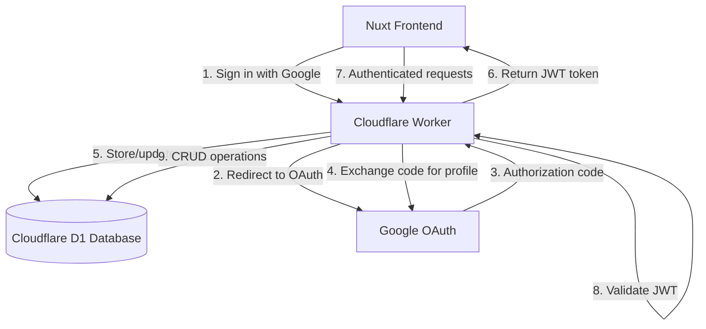
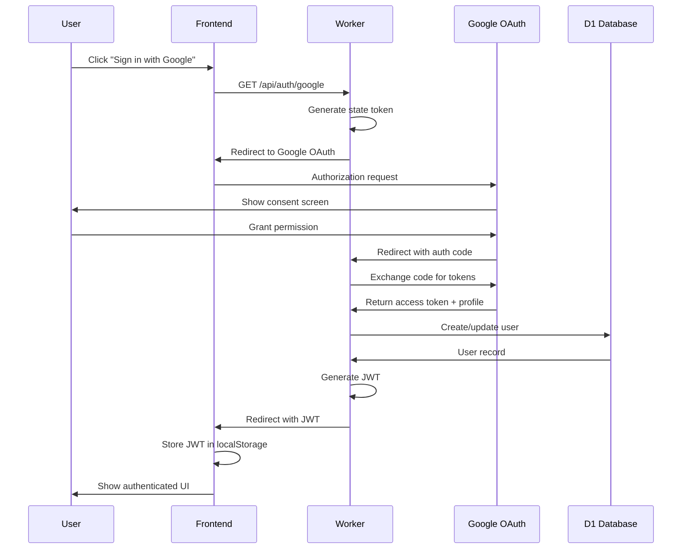

# Design Document

## Overview

This design implements a serverless authentication system using Cloudflare Workers, Google OAuth 2.0, and Cloudflare D1 (SQLite) database. The architecture maintains the platform's client-side nature while adding optional cloud-based user accounts for progress synchronization across devices. The system uses JWT tokens for session management and follows OAuth 2.0 authorization code flow for secure authentication.

## Architecture

### High-Level Architecture



### Component Architecture

The system consists of three main layers:

1. **Frontend Layer (Nuxt)**: Handles UI, local state, and API communication
2. **API Layer (Cloudflare Workers)**: Processes authentication and data operations
3. **Data Layer (Cloudflare D1)**: Persists user accounts and progress data

### Authentication Flow



## Components and Interfaces

### 1. Cloudflare Worker Structure

```
worker/
├── src/
│   ├── index.ts              # Main worker entry point
│   ├── router.ts             # Request routing
│   ├── handlers/
│   │   ├── auth.ts           # Authentication handlers
│   │   └── progress.ts       # Progress sync handlers
│   ├── middleware/
│   │   ├── auth.ts           # JWT validation middleware
│   │   └── cors.ts           # CORS middleware
│   ├── services/
│   │   ├── oauth.ts          # Google OAuth service
│   │   ├── jwt.ts            # JWT generation/validation
│   │   └── database.ts       # D1 database operations
│   ├── types/
│   │   └── index.ts          # TypeScript types
│   └── utils/
│       ├── validation.ts     # Input validation
│       └── errors.ts         # Error handling
├── tests/
│   ├── services/
│   │   ├── oauth.test.ts     # OAuth service tests
│   │   ├── jwt.test.ts       # JWT service tests
│   │   └── database.test.ts  # Database service tests
│   ├── handlers/
│   │   ├── auth.test.ts      # Auth handler tests
│   │   └── progress.test.ts  # Progress handler tests
│   ├── middleware/
│   │   ├── auth.test.ts      # Auth middleware tests
│   │   └── cors.test.ts      # CORS middleware tests
│   ├── utils/
│   │   ├── validation.test.ts # Validation tests
│   │   └── errors.test.ts    # Error handling tests
│   └── integration/
│       ├── oauth-flow.test.ts    # OAuth flow integration tests
│       └── progress-sync.test.ts # Progress sync integration tests
├── wrangler.toml             # Cloudflare configuration
├── vitest.config.ts          # Vitest configuration
└── schema.sql                # Database schema
```

### 2. API Endpoints

#### Authentication Endpoints

**GET /api/auth/google**
- Initiates OAuth flow
- Generates CSRF state token
- Redirects to Google consent screen
- Response: 302 redirect

**GET /api/auth/google/callback**
- Handles OAuth callback
- Validates state parameter
- Exchanges authorization code for tokens
- Creates/updates user in database
- Generates JWT token
- Response: 302 redirect to frontend with JWT

**GET /api/auth/me**
- Returns current user profile
- Requires: Authorization header with JWT
- Response: `{ id, email, name, picture_url }`

**POST /api/auth/logout**
- Client-side logout (clears token)
- Response: `{ success: true }`

#### Progress Endpoints

**POST /api/progress/sync**
- Syncs user progress data
- Requires: Authorization header with JWT
- Request body: `{ modules: [], quizzes: [], bookmarks: [] }`
- Response: `{ success: true, synced_at: timestamp }`

**GET /api/progress**
- Retrieves user progress data
- Requires: Authorization header with JWT
- Response: `{ modules: [], quizzes: [], bookmarks: [] }`

### 3. Frontend Integration

#### Auth Store (Pinia)

```typescript
interface AuthState {
  user: User | null
  token: string | null
  isAuthenticated: boolean
  isLoading: boolean
}

interface User {
  id: string
  email: string
  name: string
  picture_url: string
}
```

#### Auth Composable

```typescript
interface UseAuth {
  user: Ref<User | null>
  isAuthenticated: Ref<boolean>
  signInWithGoogle: () => void
  logout: () => Promise<void>
  syncProgress: () => Promise<void>
}
```

#### API Client

```typescript
class ApiClient {
  private baseUrl: string
  private getAuthHeader(): { Authorization: string } | {}
  
  async get<T>(endpoint: string): Promise<T>
  async post<T>(endpoint: string, data: any): Promise<T>
}
```

## Data Models

### Database Schema

```sql
-- Users table
CREATE TABLE users (
  id TEXT PRIMARY KEY,
  google_id TEXT UNIQUE NOT NULL,
  email TEXT UNIQUE NOT NULL,
  name TEXT NOT NULL,
  picture_url TEXT,
  created_at INTEGER NOT NULL,
  updated_at INTEGER NOT NULL
);

CREATE INDEX idx_users_google_id ON users(google_id);
CREATE INDEX idx_users_email ON users(email);

-- Progress table
CREATE TABLE progress (
  id TEXT PRIMARY KEY,
  user_id TEXT NOT NULL,
  module_id TEXT NOT NULL,
  completed INTEGER NOT NULL DEFAULT 0,
  completed_at INTEGER,
  FOREIGN KEY (user_id) REFERENCES users(id) ON DELETE CASCADE,
  UNIQUE(user_id, module_id)
);

CREATE INDEX idx_progress_user_id ON progress(user_id);

-- Quiz scores table
CREATE TABLE quiz_scores (
  id TEXT PRIMARY KEY,
  user_id TEXT NOT NULL,
  module_id TEXT NOT NULL,
  score INTEGER NOT NULL,
  total INTEGER NOT NULL,
  completed_at INTEGER NOT NULL,
  FOREIGN KEY (user_id) REFERENCES users(id) ON DELETE CASCADE
);

CREATE INDEX idx_quiz_scores_user_id ON quiz_scores(user_id);

-- Bookmarks table
CREATE TABLE bookmarks (
  id TEXT PRIMARY KEY,
  user_id TEXT NOT NULL,
  module_id TEXT NOT NULL,
  created_at INTEGER NOT NULL,
  FOREIGN KEY (user_id) REFERENCES users(id) ON DELETE CASCADE,
  UNIQUE(user_id, module_id)
);

CREATE INDEX idx_bookmarks_user_id ON bookmarks(user_id);
```

### TypeScript Interfaces

```typescript
interface User {
  id: string
  google_id: string
  email: string
  name: string
  picture_url: string | null
  created_at: number
  updated_at: number
}

interface Progress {
  id: string
  user_id: string
  module_id: string
  completed: boolean
  completed_at: number | null
}

interface QuizScore {
  id: string
  user_id: string
  module_id: string
  score: number
  total: number
  completed_at: number
}

interface Bookmark {
  id: string
  user_id: string
  module_id: string
  created_at: number
}

interface JWTPayload {
  sub: string  // user id
  email: string
  name: string
  iat: number
  exp: number
}
```

## Error Handling

### Error Types

```typescript
enum ErrorCode {
  UNAUTHORIZED = 'UNAUTHORIZED',
  INVALID_TOKEN = 'INVALID_TOKEN',
  OAUTH_FAILED = 'OAUTH_FAILED',
  DATABASE_ERROR = 'DATABASE_ERROR',
  VALIDATION_ERROR = 'VALIDATION_ERROR',
  NOT_FOUND = 'NOT_FOUND'
}

interface ApiError {
  code: ErrorCode
  message: string
  details?: any
}
```

### Error Responses

- **401 Unauthorized**: Invalid or expired JWT token
- **400 Bad Request**: Invalid input data
- **500 Internal Server Error**: Database or OAuth errors
- **404 Not Found**: Resource not found

### Frontend Error Handling

1. **Token Expiration**: Automatically logout and redirect to home
2. **Network Errors**: Show toast notification with retry option
3. **OAuth Failures**: Display error message and allow retry
4. **Sync Conflicts**: Use most recent timestamp (last-write-wins)

## Testing Strategy

### Unit Tests

All unit tests will be located in the `tests/` directory, mirroring the `src/` structure. Tests will use Vitest as the test runner with mocking capabilities for external dependencies.

1. **JWT Service** (`tests/services/jwt.test.ts`)
   - Token generation with correct payload
   - Token validation with valid/invalid/expired tokens
   - Secret key usage
   - Expiration handling
   - Signature verification

2. **OAuth Service** (`tests/services/oauth.test.ts`)
   - Authorization URL generation with state parameter
   - Token exchange with Google (mocked)
   - Profile data extraction
   - Error handling for failed OAuth requests
   - State parameter validation

3. **Database Service** (`tests/services/database.test.ts`)
   - User CRUD operations
   - Progress data operations
   - Quiz score operations
   - Bookmark operations
   - Query parameterization
   - Transaction handling
   - Error handling for database failures

4. **Validation Utils** (`tests/utils/validation.test.ts`)
   - Input sanitization
   - Email validation
   - Module ID validation
   - SQL injection prevention
   - XSS prevention

5. **Error Handling** (`tests/utils/errors.test.ts`)
   - Error code mapping
   - Error response formatting
   - Stack trace handling

6. **Auth Handler** (`tests/handlers/auth.test.ts`)
   - Google OAuth initiation
   - Callback processing
   - User profile retrieval
   - Logout handling

7. **Progress Handler** (`tests/handlers/progress.test.ts`)
   - Progress sync endpoint
   - Progress retrieval endpoint
   - Data validation
   - Conflict resolution

8. **Auth Middleware** (`tests/middleware/auth.test.ts`)
   - JWT extraction from headers
   - Token validation
   - User context attachment
   - Unauthorized request handling

9. **CORS Middleware** (`tests/middleware/cors.test.ts`)
   - CORS header application
   - Preflight request handling
   - Origin validation

### Integration Tests

Integration tests will be located in `tests/integration/` and test complete workflows across multiple components.

1. **OAuth Flow** (`tests/integration/oauth-flow.test.ts`)
   - Complete authentication flow from initiation to callback
   - State parameter generation and validation
   - User creation on first login
   - User update on subsequent logins
   - JWT token generation and return
   - Error handling throughout the flow

2. **Progress Sync** (`tests/integration/progress-sync.test.ts`)
   - Sync new progress data
   - Merge with existing data
   - Conflict resolution using timestamps
   - Multiple data types (modules, quizzes, bookmarks)
   - Batch operations

3. **Authentication Middleware** (tested within integration tests)
   - Valid token allows access to protected endpoints
   - Invalid token returns 401
   - Missing token returns 401
   - Expired token returns 401

### End-to-End Tests

1. **User Journey**
   - Sign in with Google
   - Complete a module
   - Progress syncs automatically
   - Sign out and sign back in
   - Progress persists

2. **Multi-Device Sync**
   - Complete module on device A
   - Sign in on device B
   - Progress appears on device B

## Security Considerations

### OAuth Security

1. **State Parameter**: Random token to prevent CSRF attacks
2. **Code Exchange**: Server-side exchange prevents token exposure
3. **HTTPS Only**: All OAuth redirects use HTTPS
4. **Client Secret**: Stored in environment variables, never exposed

### JWT Security

1. **Secret Key**: Strong random key stored in Cloudflare secrets
2. **Expiration**: 7-day expiration with no refresh tokens
3. **Signature**: HS256 algorithm for signing
4. **Payload**: Minimal data (id, email, name)

### Database Security

1. **Parameterized Queries**: Prevent SQL injection
2. **Input Validation**: Sanitize all user inputs
3. **Cascade Deletes**: Automatic cleanup of user data
4. **Indexes**: Optimize query performance

### CORS Configuration

```typescript
const corsHeaders = {
  'Access-Control-Allow-Origin': process.env.FRONTEND_URL,
  'Access-Control-Allow-Methods': 'GET, POST, OPTIONS',
  'Access-Control-Allow-Headers': 'Content-Type, Authorization',
  'Access-Control-Max-Age': '86400'
}
```

## Environment Variables

### Cloudflare Worker Secrets

```bash
# Google OAuth
GOOGLE_CLIENT_ID=your-client-id.apps.googleusercontent.com
GOOGLE_CLIENT_SECRET=your-client-secret
GOOGLE_REDIRECT_URI=https://api.yourdomain.com/api/auth/google/callback

# JWT
JWT_SECRET=your-secure-random-secret

# Frontend
FRONTEND_URL=https://yourdomain.com

# Database
# D1 binding configured in wrangler.toml
```

### Frontend Environment Variables

```bash
# API endpoint
NUXT_PUBLIC_API_URL=https://api.yourdomain.com
```

## Deployment Strategy

### Cloudflare Worker Deployment

1. **Development**: `wrangler dev` for local testing
2. **Staging**: Deploy to staging environment
3. **Production**: Deploy with `wrangler deploy`

### Database Migrations

1. Create D1 database: `wrangler d1 create ml-platform-db`
2. Run migrations: `wrangler d1 execute ml-platform-db --file=schema.sql`
3. Bind database in `wrangler.toml`

### Frontend Deployment

1. Update `NUXT_PUBLIC_API_URL` to worker URL
2. Build: `npm run build`
3. Deploy static files to hosting provider

## Performance Considerations

### Caching Strategy

1. **User Profile**: Cache in frontend state (Pinia)
2. **Progress Data**: Cache locally, sync on changes
3. **JWT Token**: Store in localStorage, validate on each request

### Database Optimization

1. **Indexes**: On google_id, email, user_id fields
2. **Batch Operations**: Sync multiple progress items in single request
3. **Connection Pooling**: Handled by Cloudflare D1

### Edge Computing Benefits

1. **Low Latency**: Workers run at edge locations near users
2. **Global Distribution**: Automatic worldwide deployment
3. **Scalability**: Automatic scaling with no configuration

## Migration Path

### Phase 1: Backend Setup
- Deploy Cloudflare Worker
- Set up D1 database
- Configure Google OAuth

### Phase 2: Frontend Integration
- Add auth store and composable
- Update header with sign-in button
- Implement OAuth redirect handling

### Phase 3: Progress Sync
- Add sync functionality to progress store
- Implement automatic sync on module completion
- Handle sync conflicts

### Phase 4: Testing & Rollout
- Test OAuth flow end-to-end
- Verify progress sync across devices
- Monitor error rates and performance
- Gradual rollout to users
