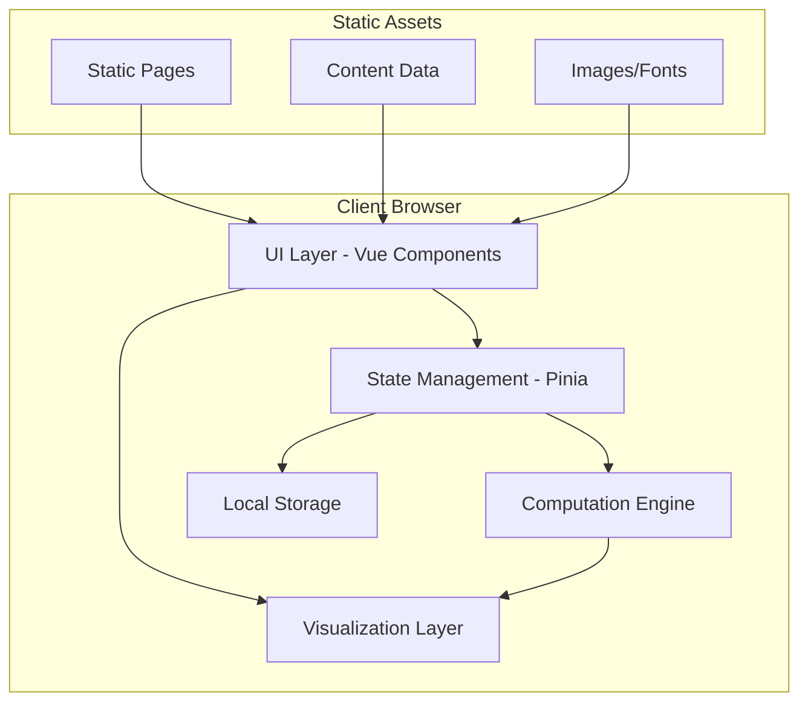

# Design Document: Interactive ML Learning Platform

## Overview

The Interactive ML Learning Platform is a browser-based educational application built with Nuxt 4 that provides hands-on learning experiences for machine learning concepts. The platform uses a modular architecture where each ML algorithm or concept is encapsulated as a self-contained module with interactive visualizations, explanatory content, and assessment quizzes.

The design emphasizes zero-setup accessibility, real-time interactivity, and progressive learning paths. All computations run client-side using JavaScript/TypeScript, with visualization libraries providing rich, interactive feedback. The platform generates as a static site for optimal performance and hosting simplicity.

### Core Design Principles

1. **Zero Setup**: Everything runs in the browser with no backend dependencies
2. **Modularity**: Each algorithm/concept is an independent, reusable module
3. **Interactivity First**: Real-time parameter adjustments with immediate visual feedback
4. **Progressive Learning**: Content organized from basic to advanced with clear learning paths
5. **Performance**: Optimized rendering, code splitting, and Web Workers for heavy computations
6. **Accessibility**: Responsive design, keyboard navigation, screen reader support

## Architecture

### High-Level Architecture



### Layer Responsibilities

#### 1. UI Layer (Vue Components)
- Renders interactive controls (sliders, inputs, buttons)
- Displays visualizations and content
- Handles user interactions
- Manages component lifecycle and reactivity

#### 2. State Management (Pinia)
- Centralized application state
- Module-specific state (parameters, data, results)
- User progress and preferences
- Quiz scores and completion tracking

#### 3. Visualization Layer
- D3.js for complex, custom visualizations (loss landscapes, network graphs)
- Plotly.js for scientific plots (scatter, line, 3D surfaces)
- Chart.js for simple charts (bar, pie, line)
- Custom Canvas/WebGL for performance-critical animations

#### 4. Computation Engine
- ML algorithm implementations in TypeScript
- Matrix operations and linear algebra utilities
- Statistical functions and metrics
- Web Workers for heavy computations (training, optimization)

#### 5. Content Management
- Markdown-based lesson content
- Structured quiz data (JSON)
- Module metadata and navigation structure

## Components and Interfaces

### Core Component Hierarchy

```
App
├── Layout
│   ├── Header (Navigation, Progress)
│   ├── Sidebar (Module Navigation)
│   └── Footer
├── Pages
│   ├── Home
│   ├── About
│   ├── Module Pages
│   │   ├── ModuleLayout
│   │   │   ├── ContentSection
│   │   │   ├── InteractiveSection
│   │   │   │   ├── ControlPanel
│   │   │   │   └── VisualizationPanel
│   │   │   └── QuizSection
│   └── Marketing Pages
└── Shared Components
    ├── Slider
    ├── Button
    ├── Tooltip
    ├── Chart
    └── DataTable
```

### Key Component Interfaces

#### ModuleLayout Component
```typescript
interface ModuleLayoutProps {
  moduleId: string;
  title: string;
  domain: 'regression' | 'classification' | 'clustering' | 'preprocessing' | 'optimization' | 'advanced';
  difficulty: 'beginner' | 'intermediate' | 'advanced';
}
```

#### InteractiveSection Component
```typescript
interface InteractiveSectionProps {
  algorithmId: string;
  initialParams: Record<string, number | string | boolean>;
  datasetOptions: DatasetOption[];
  onParamChange: (params: Record<string, any>) => void;
}
```

#### VisualizationPanel Component
```typescript
interface VisualizationPanelProps {
  type: 'scatter' | 'line' | 'heatmap' | '3d' | 'network' | 'custom';
  data: VisualizationData;
  config: VisualizationConfig;
  interactive: boolean;
  onInteraction?: (event: InteractionEvent) => void;
}
```

#### ControlPanel Component
```typescript
interface ControlPanelProps {
  controls: Control[];
  values: Record<string, any>;
  onChange: (key: string, value: any) => void;
  onReset: () => void;
}

interface Control {
  id: string;
  type: 'slider' | 'input' | 'select' | 'checkbox' | 'toggle';
  label: string;
  min?: number;
  max?: number;
  step?: number;
  options?: { label: string; value: any }[];
  tooltip?: string;
}
```

#### QuizSection Component
```typescript
interface QuizSectionProps {
  questions: Question[];
  onComplete: (score: number, answers: Answer[]) => void;
}

interface Question {
  id: string;
  text: string;
  type: 'multiple-choice' | 'true-false' | 'fill-blank';
  options?: string[];
  correctAnswer: string | number;
  explanation: string;
}
```

### Pinia Store Interfaces

#### Module Store
```typescript
interface ModuleState {
  currentModule: string | null;
  parameters: Record<string, any>;
  dataset: DataPoint[];
  results: AlgorithmResults | null;
  isTraining: boolean;
  trainingProgress: number;
}

interface ModuleStore {
  state: ModuleState;
  actions: {
    setParameter(key: string, value: any): void;
    loadDataset(datasetId: string): void;
    runAlgorithm(): Promise<void>;
    resetModule(): void;
  };
  getters: {
    currentParams: Record<string, any>;
    hasResults: boolean;
  };
}
```

#### Progress Store
```typescript
interface ProgressState {
  completedModules: string[];
  quizScores: Record<string, number>;
  bookmarks: Bookmark[];
  lastVisited: string | null;
  totalTimeSpent: number;
}

interface ProgressStore {
  state: ProgressState;
  actions: {
    markModuleComplete(moduleId: string): void;
    saveQuizScore(moduleId: string, score: number): void;
    addBookmark(bookmark: Bookmark): void;
    clearProgress(): void;
  };
  getters: {
    completionPercentage: number;
    averageQuizScore: number;
  };
}
```

#### Analytics Store
```typescript
interface AnalyticsState {
  events: AnalyticsEvent[];
  sessionStart: number;
  optedIn: boolean;
}

interface AnalyticsStore {
  actions: {
    trackEvent(event: AnalyticsEvent): void;
    trackPageView(page: string): void;
    trackInteraction(moduleId: string, action: string): void;
    setOptIn(value: boolean): void;
  };
}
```

## Data Models

### Algorithm Module Model
```typescript
interface AlgorithmModule {
  id: string;
  name: string;
  domain: Domain;
  difficulty: Difficulty;
  description: string;
  learningObjectives: string[];
  prerequisites: string[];
  estimatedTime: number; // minutes
  content: ModuleContent;
  interactive: InteractiveConfig;
  quiz: Quiz;
}

interface ModuleContent {
  introduction: string; // Markdown
  sections: ContentSection[];
  summary: string; // Markdown
  resources: Resource[];
}

interface ContentSection {
  title: string;
  content: string; // Markdown
  visualAid?: string; // Image or diagram reference
}

interface InteractiveConfig {
  algorithm: string; // Algorithm implementation reference
  defaultParams: Record<string, any>;
  controls: Control[];
  visualizations: VisualizationConfig[];
  datasets: DatasetOption[];
}
```

### Dataset Model
```typescript
interface Dataset {
  id: string;
  name: string;
  description: string;
  type: 'regression' | 'classification' | 'clustering';
  features: number;
  samples: number;
  data: DataPoint[];
}

interface DataPoint {
  features: number[];
  label?: number | string;
  id?: string;
}
```

### Algorithm Results Model
```typescript
interface AlgorithmResults {
  predictions?: number[] | string[];
  model?: ModelParameters;
  metrics?: Metrics;
  visualizationData?: VisualizationData;
  trainingHistory?: TrainingHistory;
}

interface ModelParameters {
  weights?: number[];
  bias?: number;
  centers?: number[][];
  tree?: DecisionNode;
  // Algorithm-specific parameters
  [key: string]: any;
}

interface Metrics {
  accuracy?: number;
  precision?: number;
  recall?: number;
  f1Score?: number;
  mse?: number;
  rmse?: number;
  r2Score?: number;
  confusionMatrix?: number[][];
  rocCurve?: { fpr: number[]; tpr: number[]; auc: number };
}

interface TrainingHistory {
  epochs: number[];
  loss: number[];
  valLoss?: number[];
  accuracy?: number[];
  valAccuracy?: number[];
}
```

### Visualization Data Model
```typescript
interface VisualizationData {
  type: VisualizationType;
  data: any; // Type varies by visualization
  layout?: PlotLayout;
  config?: PlotConfig;
}

type VisualizationType = 
  | 'scatter2d'
  | 'scatter3d'
  | 'line'
  | 'heatmap'
  | 'contour'
  | 'surface'
  | 'network'
  | 'tree'
  | 'confusion-matrix'
  | 'roc-curve'
  | 'loss-landscape';
```

## Algorithm Implementation Architecture

### Base Algorithm Interface
```typescript
interface Algorithm {
  name: string;
  fit(X: number[][], y?: number[]): Promise<void>;
  predict(X: number[][]): number[] | string[];
  getVisualizationData(): VisualizationData;
  getMetrics(): Metrics;
  reset(): void;
}
```

### Example: Linear Regression Implementation
```typescript
class LinearRegression implements Algorithm {
  private weights: number[] = [];
  private bias: number = 0;
  private history: TrainingHistory = { epochs: [], loss: [] };
  
  constructor(
    private learningRate: number = 0.01,
    private epochs: number = 100
  ) {}
  
  async fit(X: number[][], y: number[]): Promise<void> {
    // Implementation with gradient descent
    // Use Web Worker for heavy computation
  }
  
  predict(X: number[][]): number[] {
    // Prediction logic
  }
  
  getVisualizationData(): VisualizationData {
    // Return data for plotting regression line, residuals, etc.
  }
  
  getMetrics(): Metrics {
    // Calculate MSE, RMSE, R²
  }
}
```

### Computation Worker Architecture
```typescript
// worker.ts
interface WorkerMessage {
  type: 'train' | 'predict' | 'optimize';
  algorithm: string;
  data: any;
  params: any;
}

interface WorkerResponse {
  type: 'progress' | 'complete' | 'error';
  data: any;
  progress?: number;
}

// Heavy computations run in Web Worker
self.onmessage = (e: MessageEvent<WorkerMessage>) => {
  const { type, algorithm, data, params } = e.data;
  
  switch (type) {
    case 'train':
      // Run training algorithm
      // Post progress updates
      break;
    case 'predict':
      // Run predictions
      break;
  }
};
```

## Visualization Strategy

### Visualization Library Selection

| Use Case | Library | Rationale |
|----------|---------|-----------|
| Scientific plots (scatter, line, 3D) | Plotly.js | Rich interactivity, 3D support, good performance |
| Custom visualizations (loss landscapes, networks) | D3.js | Maximum flexibility, custom interactions |
| Simple charts (bar, pie) | Chart.js | Lightweight, simple API |
| Performance-critical animations | Custom Canvas/WebGL | 60fps for real-time updates |

### Visualization Component Pattern
```typescript
// Base visualization composable
export function useVisualization(type: VisualizationType) {
  const container = ref<HTMLElement>();
  const instance = ref<any>();
  
  const render = (data: VisualizationData) => {
    // Render based on type
  };
  
  const update = (data: VisualizationData) => {
    // Update existing visualization
  };
  
  const destroy = () => {
    // Cleanup
  };
  
  return { container, render, update, destroy };
}
```

### Real-Time Update Strategy
- Debounce parameter changes (100ms) to avoid excessive re-renders
- Use requestAnimationFrame for smooth animations
- Implement virtual scrolling for large datasets
- Cache computed results when parameters haven't changed
- Use Vue's reactive system efficiently with computed properties

## Error Handling

### Error Categories

1. **User Input Errors**
   - Invalid parameter values
   - Incompatible dataset selections
   - Missing required inputs

2. **Computation Errors**
   - Numerical instability (overflow, underflow)
   - Non-convergence in optimization
   - Insufficient data for algorithm

3. **Visualization Errors**
   - Failed to render chart
   - Browser compatibility issues
   - Performance degradation

4. **Storage Errors**
   - LocalStorage quota exceeded
   - Failed to save/load progress

### Error Handling Strategy

```typescript
// Centralized error handler
class ErrorHandler {
  handle(error: AppError): void {
    switch (error.category) {
      case 'user-input':
        this.showUserFriendlyMessage(error);
        break;
      case 'computation':
        this.handleComputationError(error);
        break;
      case 'visualization':
        this.fallbackVisualization(error);
        break;
      case 'storage':
        this.handleStorageError(error);
        break;
    }
    
    // Log for analytics
    this.logError(error);
  }
  
  private showUserFriendlyMessage(error: AppError): void {
    // Display toast notification with helpful message
  }
  
  private handleComputationError(error: AppError): void {
    // Suggest parameter adjustments or dataset changes
  }
}
```

### Validation Strategy
```typescript
// Parameter validation
interface ValidationRule {
  type: 'range' | 'required' | 'custom';
  message: string;
  validate: (value: any) => boolean;
}

class ParameterValidator {
  validate(params: Record<string, any>, rules: Record<string, ValidationRule[]>): ValidationResult {
    const errors: Record<string, string> = {};
    
    for (const [key, value] of Object.entries(params)) {
      const paramRules = rules[key] || [];
      for (const rule of paramRules) {
        if (!rule.validate(value)) {
          errors[key] = rule.message;
          break;
        }
      }
    }
    
    return {
      valid: Object.keys(errors).length === 0,
      errors
    };
  }
}
```

## Testing Strategy

### Testing Pyramid

```
        /\
       /  \
      / E2E \
     /______\
    /        \
   /Integration\
  /____________\
 /              \
/  Unit Tests    \
/________________\
```

### Unit Testing
- **Algorithm Logic**: Test each ML algorithm implementation
  - Correctness of predictions
  - Convergence behavior
  - Edge cases (empty data, single point, etc.)
- **Utility Functions**: Matrix operations, statistical functions
- **Validation Logic**: Parameter validators, input sanitizers
- **Store Actions**: Pinia store mutations and actions

```typescript
// Example: Linear Regression Tests
describe('LinearRegression', () => {
  it('should fit a simple linear relationship', () => {
    const model = new LinearRegression();
    const X = [[1], [2], [3], [4]];
    const y = [2, 4, 6, 8];
    
    model.fit(X, y);
    const predictions = model.predict([[5]]);
    
    expect(predictions[0]).toBeCloseTo(10, 1);
  });
  
  it('should handle empty dataset gracefully', () => {
    const model = new LinearRegression();
    expect(() => model.fit([], [])).toThrow('Insufficient data');
  });
});
```

### Integration Testing
- **Component Integration**: Test component interactions with stores
- **Visualization Rendering**: Test that visualizations render with correct data
- **User Flows**: Test complete user interactions (adjust params → train → view results)

```typescript
// Example: Module Integration Test
describe('LinearRegressionModule', () => {
  it('should update visualization when parameters change', async () => {
    const wrapper = mount(LinearRegressionModule);
    
    await wrapper.find('[data-test="learning-rate-slider"]').setValue(0.1);
    await wrapper.find('[data-test="train-button"]').trigger('click');
    
    await waitFor(() => {
      expect(wrapper.find('[data-test="loss-chart"]').exists()).toBe(true);
    });
  });
});
```

### E2E Testing
- **Critical User Paths**: Complete learning flows from start to quiz
- **Cross-Browser**: Test on Chrome, Firefox, Safari
- **Responsive**: Test on different viewport sizes
- **Performance**: Measure load times and interaction responsiveness

```typescript
// Example: E2E Test with Playwright
test('user can complete linear regression module', async ({ page }) => {
  await page.goto('/modules/regression/linear-regression');
  
  // Adjust parameters
  await page.locator('[data-test="learning-rate-slider"]').fill('0.1');
  
  // Train model
  await page.locator('[data-test="train-button"]').click();
  
  // Wait for results
  await page.waitForSelector('[data-test="results-section"]');
  
  // Complete quiz
  await page.locator('[data-test="quiz-answer-1"]').click();
  await page.locator('[data-test="submit-quiz"]').click();
  
  // Verify completion
  await expect(page.locator('[data-test="completion-badge"]')).toBeVisible();
});
```

### Visual Regression Testing
- Snapshot testing for visualizations
- Ensure consistent rendering across updates
- Use tools like Percy or Chromatic

## Performance Optimization

### Code Splitting Strategy
```typescript
// nuxt.config.ts
export default defineNuxtConfig({
  vite: {
    build: {
      rollupOptions: {
        output: {
          manualChunks: {
            'algorithms-regression': ['~/algorithms/regression/*'],
            'algorithms-classification': ['~/algorithms/classification/*'],
            'viz-plotly': ['plotly.js'],
            'viz-d3': ['d3'],
          }
        }
      }
    }
  }
});
```

### Lazy Loading
- Lazy load algorithm implementations
- Lazy load visualization libraries
- Lazy load module content

```typescript
// Lazy load algorithm
const LinearRegression = defineAsyncComponent(() =>
  import('~/algorithms/regression/LinearRegression')
);

// Lazy load visualization
const PlotlyChart = defineAsyncComponent(() =>
  import('~/components/visualizations/PlotlyChart.vue')
);
```

### Computation Optimization
- Use Web Workers for training algorithms
- Implement memoization for expensive calculations
- Use typed arrays for numerical computations
- Batch updates to reduce re-renders

```typescript
// Memoized computation
const computedResults = computed(() => {
  const key = JSON.stringify(params.value);
  if (cache.has(key)) {
    return cache.get(key);
  }
  const result = expensiveComputation(params.value);
  cache.set(key, result);
  return result;
});
```

### Rendering Optimization
- Virtual scrolling for large lists
- Canvas-based rendering for many data points
- Debounce/throttle user inputs
- Use CSS transforms for animations (GPU acceleration)

## Accessibility

### WCAG 2.1 AA Compliance

1. **Keyboard Navigation**
   - All interactive elements accessible via keyboard
   - Visible focus indicators
   - Logical tab order

2. **Screen Reader Support**
   - Semantic HTML elements
   - ARIA labels for custom controls
   - Live regions for dynamic updates

3. **Color Contrast**
   - Minimum 4.5:1 contrast ratio for text
   - 3:1 for large text and UI components
   - Don't rely solely on color for information

4. **Responsive Text**
   - Support text zoom up to 200%
   - Relative units (rem, em) for font sizes

### Implementation Examples
```vue
<!-- Accessible slider -->
<div class="slider-control">
  <label :for="`slider-${id}`">{{ label }}</label>
  <input
    :id="`slider-${id}`"
    type="range"
    :min="min"
    :max="max"
    :step="step"
    :value="modelValue"
    @input="$emit('update:modelValue', $event.target.value)"
    :aria-valuemin="min"
    :aria-valuemax="max"
    :aria-valuenow="modelValue"
    :aria-label="ariaLabel"
  />
  <output :for="`slider-${id}`">{{ modelValue }}</output>
</div>

<!-- Accessible visualization -->
<figure role="img" :aria-label="chartDescription">
  <div ref="chartContainer"></div>
  <figcaption>{{ chartCaption }}</figcaption>
</figure>

<!-- Live region for dynamic updates -->
<div role="status" aria-live="polite" aria-atomic="true" class="sr-only">
  {{ statusMessage }}
</div>
```

## Security Considerations

### Client-Side Security

1. **Input Sanitization**
   - Validate all user inputs
   - Sanitize any user-generated content
   - Prevent XSS through proper escaping

2. **Local Storage**
   - Don't store sensitive information
   - Implement storage quotas
   - Handle storage errors gracefully

3. **Third-Party Scripts**
   - Use SRI (Subresource Integrity) for CDN resources
   - Minimize third-party dependencies
   - Regular security audits of dependencies

4. **Analytics Privacy**
   - Anonymous data collection only
   - Clear opt-in/opt-out mechanisms
   - GDPR compliance for EU users
   - No PII collection without explicit consent

## Deployment Architecture

### Static Site Generation
```typescript
// nuxt.config.ts
export default defineNuxtConfig({
  ssr: true,
  nitro: {
    preset: 'static',
    prerender: {
      crawlLinks: true,
      routes: [
        '/',
        '/about',
        '/modules/regression/linear-regression',
        // ... all module routes
      ]
    }
  }
});
```

### Hosting Options
- **Vercel**: Automatic deployments, edge network, analytics
- **Netlify**: Similar features, good DX
- **GitHub Pages**: Free, simple for open-source
- **Cloudflare Pages**: Fast edge network, generous free tier

### CDN Strategy
- Serve static assets from CDN
- Cache-Control headers for optimal caching
- Versioned assets for cache busting

### Performance Monitoring
- Core Web Vitals tracking
- Real User Monitoring (RUM)
- Error tracking (Sentry)
- Analytics (Plausible or privacy-focused alternative)

## Content Management System

### File Structure
```
content/
├── modules/
│   ├── regression/
│   │   ├── linear-regression/
│   │   │   ├── content.md
│   │   │   ├── config.json
│   │   │   └── quiz.json
│   │   └── logistic-regression/
│   ├── classification/
│   ├── clustering/
│   ├── preprocessing/
│   ├── optimization/
│   └── advanced/
└── pages/
    ├── home.md
    ├── about.md
    └── why-learn-here.md
```

### Module Configuration Schema
```json
{
  "id": "linear-regression",
  "name": "Linear Regression",
  "domain": "regression",
  "difficulty": "beginner",
  "estimatedTime": 30,
  "prerequisites": [],
  "learningObjectives": [
    "Understand the concept of linear relationships",
    "Learn how gradient descent optimizes parameters",
    "Interpret model coefficients and metrics"
  ],
  "interactive": {
    "algorithm": "LinearRegression",
    "defaultParams": {
      "learningRate": 0.01,
      "epochs": 100
    },
    "controls": [
      {
        "id": "learningRate",
        "type": "slider",
        "label": "Learning Rate",
        "min": 0.001,
        "max": 0.1,
        "step": 0.001,
        "tooltip": "Controls how quickly the model learns"
      }
    ],
    "datasets": ["simple-linear", "noisy-linear", "polynomial"]
  }
}
```

### Content Authoring Workflow
1. Create module directory structure
2. Write content in Markdown with frontmatter
3. Define interactive configuration in JSON
4. Create quiz questions in JSON
5. Implement algorithm if not exists
6. Test module locally
7. Deploy (automatic via CI/CD)

## Technology Stack Summary

### Core Framework
- **Nuxt 4**: Vue-based framework with SSR/SSG
- **Vue 3**: Composition API for reactive components
- **TypeScript**: Type safety throughout

### State Management
- **Pinia**: Centralized state management

### Styling
- **Tailwind CSS**: Utility-first CSS framework
- **Custom Design System**: Consistent components

### Visualizations
- **Plotly.js**: Scientific plots and 3D visualizations
- **D3.js**: Custom, complex visualizations
- **Chart.js**: Simple charts
- **Custom Canvas/WebGL**: Performance-critical animations

### Algorithms & Computation
- **TypeScript**: Algorithm implementations
- **Web Workers**: Heavy computations
- **Math.js**: Mathematical utilities (if needed)

### Testing
- **Vitest**: Unit testing
- **Vue Test Utils**: Component testing
- **Playwright**: E2E testing

### Build & Deploy
- **Vite**: Fast bundling and dev server
- **Vercel/Netlify**: Static hosting with CI/CD

### Analytics & Monitoring
- **Plausible**: Privacy-focused analytics
- **Sentry**: Error tracking
- **Web Vitals**: Performance monitoring

## Migration Path from Current Setup

Current state: Basic Nuxt 4 setup with fonts, icons, images, and scripts modules.

### Phase 1: Foundation
1. Install additional dependencies (Pinia, Tailwind, visualization libraries)
2. Set up Tailwind configuration
3. Create base design system components
4. Set up Pinia stores structure
5. Configure static site generation

### Phase 2: Core Infrastructure
1. Implement base algorithm interface and utilities
2. Create visualization composables
3. Build module layout components
4. Set up content management structure
5. Implement local storage utilities

### Phase 3: First Module
1. Implement linear regression algorithm
2. Create linear regression module page
3. Build interactive controls
4. Add visualizations
5. Write content and quiz
6. Test end-to-end

### Phase 4: Expansion
1. Add more algorithms following the pattern
2. Build domain navigation
3. Implement progress tracking
4. Add marketing pages
5. Set up analytics

### Phase 5: Polish & Launch
1. Performance optimization
2. Accessibility audit
3. Cross-browser testing
4. SEO optimization
5. Deploy to production
